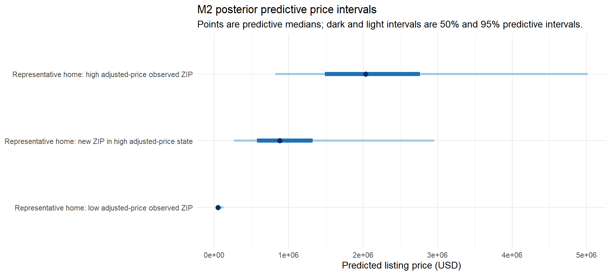

# Bayesian Modeling of U.S. Real Estate Listing Prices

How much does location improve listing-price predictions after accounting for property characteristics? This project compares three Bayesian regression models using **18,000 residential listings across 25 states and 600 state–ZIP groups**. The selected R/JAGS model reduced held-out RMSE by **44%** versus pooled regression, with **95.4% empirical coverage** for its 95% predictive intervals.

[Download the full HTML report](report/report.html) and open it in a browser, or inspect the [results table](output/tables/report_dic_heldout_model_comparison.csv) and [selected model](models/m2_heteroskedastic_state_sigma.jags) directly on GitHub.

## Results

All models use the same frozen split: 14,400 training listings and 3,600 held-out listings. RMSE and MAE are measured on the standardized log listing-price scale. Coverage is the share of held-out observations inside the nominal 95% posterior predictive intervals.

| Model | Held-out RMSE ↓ | Held-out MAE ↓ | 95% interval coverage |
| --- | ---: | ---: | ---: |
| M0 · Pooled Bayesian regression | 0.7623 | 0.5574 | 95.2% |
| M1 · State random intercepts | 0.5970 | 0.4288 | 95.7% |
| **M2 · State and ZIP random intercepts, varying residual variance** | **0.4241** | **0.2825** | **95.4%** |

M2 also had the best mean log predictive density and the lowest in-sample DIC. Both measures are in the [full comparison table](output/tables/report_dic_heldout_model_comparison.csv).



The chart shows example predictions in dollars for a representative home across three geographic scenarios. The held-out metrics above evaluate listings in state–ZIP groups the model saw during training.

## Approach

1. **Audit and sample.** Clean the [2.23 million source rows](output/tables/report_cleaning_sampling_row_accounting.csv), then build a balanced sample with 30 listings per state–ZIP group. Each group contributes 24 training listings and six held-out listings.
2. **Fit a model ladder.** Predict log listing price using living area, lot size, bedrooms, bathrooms, and listing status. Add state effects in M1, then nested ZIP effects and residual variance that depends on property characteristics and state in M2. Use the training set for standardization.
3. **Check the fit and predictions.** Assess the modeling assumptions with prior predictive checks and simulation recovery. Review four MCMC chains (40,000 retained posterior draws for M2), compare models on the same held-out listings, and use posterior predictive checks to see where the selected model misses.

**Scope.** The split measures performance within the sampled markets. A geographic or temporal holdout would be needed to assess performance in new markets or future periods. The balanced sample supports comparison across the selected markets, and the target is the asking price. M2 captures much of the ZIP-level variation, but its simulated listing-price distribution still has a wider interquartile range and a higher 90th percentile than observed. See the [posterior predictive checks](output/figures/m2_posterior_predictive_checks.png) and [underlying statistics](output/tables/report_posterior_predictive_test_statistics.csv).

## Where to look in the code

| Resource | What it shows |
| --- | --- |
| [Sampling script](scripts/02_make_sample.R) and [JAGS inputs](scripts/03_prepare_jags_data.R) | Balanced sampling, frozen split, and training-based scaling |
| [M2 specification](models/m2_heteroskedastic_state_sigma.jags) and [fitting script](scripts/05_fit_models.R) | Nested effects, varying residual scale, and MCMC |
| [Model comparison](scripts/07_model_comparison.R) and [prediction intervals](scripts/10_posterior_predictions.R) | Held-out scoring and uncertainty for representative listings |
| [Model-selection note](docs/selected_m2.md) and [report source](report/report.Rmd) | How the earlier M2 variant was revised and reported |

## Reproduce the analysis

The report, [tables](output/tables), and [figures](output/figures) are already in the repository. To refit the models, use R 4.5.2 (the version in [renv.lock](renv.lock)) and a system installation of JAGS 4.x. Restore the R packages with `Rscript -e 'renv::restore(prompt = FALSE)'` from the repository root.

Download version 25 of the [USA Real Estate Dataset](https://www.kaggle.com/datasets/ahmedshahriarsakib/usa-real-estate-dataset) and place the CSV at `data/raw/realtor-data.csv`. The original file is 178,858,272 bytes and has MD5 `09ce5bd36ef648a5769a996735c05951`. The upstream dataset terms apply to the CSV.

<details>
<summary>Commands for a fresh fit and optional report render</summary>

Run from the repository root. The full M2 fit can take many hours. Scripts reuse saved draws where supported.

```sh
Rscript scripts/01_data_audit.R
Rscript scripts/02_make_sample.R
Rscript scripts/03_prepare_jags_data.R
Rscript scripts/04_prior_predictive_checks.R
Rscript scripts/04_simulation_recovery.R
Rscript scripts/05_fit_models.R
Rscript scripts/06_diagnostics.R
Rscript scripts/07_lightweight_dic.R
Rscript scripts/07_model_comparison.R
Rscript scripts/08_posterior_predictive_checks.R
Rscript scripts/10_posterior_predictions.R
Rscript scripts/09_make_figures_tables.R
```

To regenerate the HTML after the artifacts are in place, install Pandoc and run `Rscript -e 'rmarkdown::render("report/report.Rmd")'`. The report reads the saved tables and figures. The [legacy prior-sensitivity script](scripts/11_sensitivity_analyses.R) is separate from the selected M2 pipeline and expects the earlier M2 draws.

</details>
